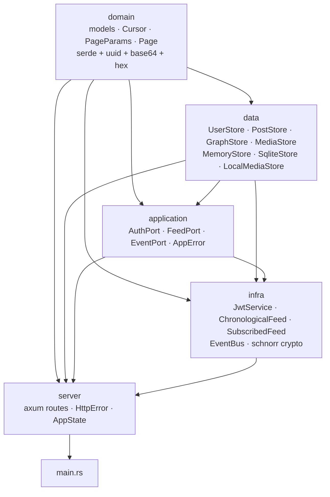

# Architecture

## Positioning

mini-social-feed is a **capability-based application backend** — not a database,
not a raw data server. It serves typed, validated, policy-governed primitives
(Users, Posts, Media, Relationships) that applications compose into feeds, DMs,
notifications, agent pipelines. The same binary runs as a homeserver or behind a
load balancer.

## Crate dependency graph



No circular dependencies. The domain crate has **zero knowledge** of HTTP, crypto,
or persistence. The data crate is a standalone persistence engine.

## Crate: `domain`

**Pure data.** Dependencies: `serde`, `uuid`, `thiserror`, `base64`, `hex`.

### Key types

| Type | Description |
|---|---|
| `UserId(String)` | UUIDv7 — time-sortable, 32 hex chars |
| `PostId(String)` | UUIDv7 — time-sortable, 32 hex chars |
| `MediaId(String)` | UUIDv7 — media identifier |
| `User` | `id`, `username` (unique), `password_hash`, `api_key_hash?`, `bio?`, `nostr_pubkey?`, `email?`, `avatar_media_id?`, `created_at` |
| `Post` | `id`, `author_id`, `content`, `parent_id?`, `media_ids[]`, `created_at`, `nostr_event_id?`, `nostr_sig?` |
| `EntityId` | Enum: `User(UserId)` or `Post(PostId)` — graph node identity |
| `Relation` | Enum: `Reply`, `Subscribe`, `ConnectRequest`, `Connected`, `Block`, `Mention` |
| `Direction` | Enum: `Outbound`, `Inbound` — graph traversal |
| `Cursor(String)` | Opaque pagination cursor encoding `(created_at, id)` |
| `PageParams` | `after?`, `before?`, `page_size?` (alias `limit`), `since?`, `until?` |
| `Page<T>` | `items`, `total`, `page_size`, `first`, `last` — cursor-based page envelope |
| `MediaRef` | `id`, `url`, `backend`, `content_type`, `size_bytes`, `deleted` — resolved media |
| `DomainError` | `ContentTooLarge`, `UsernameTooLong`, `UsernameEmpty`, `BioTooLong`, etc. |

### Constants

- `MAX_CONTENT_SIZE = 16 * 1024`
- `MAX_USERNAME_LEN = 64`
- `MAX_BIO_LEN = 512`

## Crate: `data`

**Standalone persistence engine.** Depends on `domain`. Zero knowledge of HTTP, auth, or feeds.

### Ports (traits)

| Trait | Purpose | Key methods |
|---|---|---|
| `UserStore` | User CRUD + search | `create`, `get_by_id`, `get_by_username`, `get_by_api_key_hash`, `set_api_key_hash`, `set_avatar`, `set_nostr_pubkey`, `update_profile`, `search`, `get_space_used` |
| `PostStore` | Post CRUD + search + cursor pagination | `create_post`, `get_post`, `get_posts(&PageParams, Option<&UserId>) -> Page<Post>`, `get_user_posts` (legacy), `get_thread_posts`, `search_posts` |
| `GraphStore` | Entity relationship management | `relate`, `unrelate`, `related`, `check_relation` |
| `MediaStore` | Binary content storage | `upload`, `get_file`, `delete`, `get_url`, `resolve_batch` |

### Implementations

- **`MemoryStore`** — single struct implementing all data ports via `Arc<RwLock<Inner>>`
- **`SqliteStore`** — single struct with `sqlx::SqlitePool`, WAL mode, auto-migration
- **`LocalMediaStore`** — disk-backed media with metadata in `uploads/meta/`

### Media policy

`MediaPolicy` controls upload limits per deployment tier:

| Tier | Per-image | Per-post | Per-user total |
|---|---|---|---|
| `minimal` | 1 MB | 1 | 10 MB |
| `standard` | 10 MB | 4 | 100 MB |
| `generous` | 50 MB | 20 | 1 GB |

Avatars: 2 MB, square, JPEG/PNG/WebP — same across all tiers.

## Crate: `application`

**Ports (interfaces).** Depends only on `domain`. Zero knowledge of implementations.

### `AuthPort` trait

```rust
#[async_trait]
pub trait AuthPort: Send + Sync + 'static {
    async fn register(&self, username: &str, password: &str) -> Result<User, AppError>;
    async fn login(&self, username: &str, password: &str) -> Result<User, AppError>;
    async fn create_api_key(&self, user_id: &UserId) -> Result<String, AppError>;
    async fn verify_api_key(&self, key: &str) -> Result<UserId, AppError>;
    fn create_token(&self, user_id: &str) -> Result<String, AppError>;
    fn verify_token(&self, token: &str) -> Result<String, AppError>;
    async fn create_refresh_token(&self, user_id: &str) -> Result<String, AppError>;
    async fn consume_refresh_token(&self, token: &str) -> Result<String, AppError>;
    async fn revoke_token_family(&self, user_id: &str) -> Result<(), AppError>;
    async fn create_challenge(&self, public_key: &str) -> Result<(String, [u8; 32]), AppError>;
    async fn verify_challenge(&self, challenge_id: &str, pubkey: &str, sig: &str) -> Result<(), AppError>;
}
```

### `FeedPort` trait

```rust
#[async_trait]
pub trait FeedPort: Send + Sync + 'static {
    async fn get_feed(
        &self,
        viewer: Option<&UserId>,
        params: &PageParams,
    ) -> Result<Page<Post>, AppError>;
}
```

### `EventPort` trait

```rust
#[async_trait]
pub trait EventPort: Send + Sync + 'static {
    async fn emit(&self, event: SystemEvent) -> Result<(), AppError>;
    async fn subscribe(&self) -> Result<EventReceiver, AppError>;
}
```

### `AppError`

Unified error type: `NotFound`, `Duplicate`, `Unauthorized`, `InvalidToken`,
`TokenFamilyRevoked`, `BadRequest`, `Internal`, `Data(DataError)`, `Domain(DomainError)`.

## Crate: `infra`

**All implementations.** Depends on `domain`, `data`, and `application`.

### `JwtService` (implements `AuthPort`)

- argon2id password hashing (register + login)
- HS256 JWT with 15-min expiry
- Refresh tokens: opaque UUID, SHA-256 hashed before storage, 7-day TTL, one-time-use with rotation, stale-token detection revokes family
- API keys: SHA-256 hashed, used as Bearer tokens directly (no JWT needed)
- Nostr challenge flow: Schnorr (BIP340), 32-byte nonce, 5-min TTL, one-time-use

### `ChronologicalFeed` / `SubscribedFeed` (implement `FeedPort`)

- `ChronologicalFeed`: delegates to `PostStore::get_posts(params, None)` — newest-first, no ranking
- `SubscribedFeed`: resolves viewer's subscriptions via `GraphStore`, then filters cursor-paginated results from `PostStore`
- Swappable — wire a different `FeedPort` impl at startup

### `EventBus` (implements `EventPort`)

- tokio broadcast channel
- Emits `SystemEvent` variants: `PostCreated`, `ReplyReceived`, `UserRegistered`
- SSE endpoint at `/api/events` consumes the stream

### Schnorr crypto

- Curve: secp256k1 via `k256` (BIP340, same as Nostr)
- Functions: `schnorr_verify(pubkey_hex, msg_bytes, sig_hex) -> Result<(), AppError>`
- Accepts both 32-byte (x-only) and 33-byte (compressed) pubkeys

## Crate: `server`

**HTTP adapter.** Axum 0.7 routes, error mapping, auth middleware.

### `AppState`

```rust
pub struct AppState {
    pub users: Arc<dyn UserStore>,
    pub posts: Arc<dyn PostStore>,
    pub graph: Arc<dyn GraphStore>,
    pub media_local: Option<Arc<dyn MediaStore>>,
    pub media_cloud: Option<Arc<dyn MediaStore>>,
    pub media_local_policy: Option<MediaPolicy>,
    pub auth: Arc<dyn AuthPort>,
    pub feed: Arc<dyn FeedPort>,
    pub event: Arc<dyn EventPort>,
}
```

All fields are trait objects — swap implementations without touching the server.

### Error handling

```
DomainError  ──→  HttpError::BadRequest
DataError    ──→  HttpError (NotFound / Conflict / Internal)
AppError     ──→  HttpError (NotFound / Conflict / Unauthorized / BadRequest / Internal)
```

### `AuthUser` extractor

Tries API key first (via `UserStore::get_by_api_key_hash`), falls back to JWT
(via `AuthPort::verify_token`). Injects `AuthUser(UserId)` into handlers.

### Thread model

Posts form a **simple tree**: each post has at most one `parent_id`.

```
[Root] → [Reply 1] → [Nested]
       → [Reply 2]
```

`get_thread_posts` returns a BFS list. `build_thread_tree` converts it to nested
`ThreadResponse` JSON.

### Pagination protocol

All list endpoints use cursor-based pagination:

```
GET /api/posts?limit=30                          → first page
GET /api/posts?limit=30&before=<cursor>          → next page (older)
GET /api/posts?limit=30&after=<cursor>           → previous page (newer)
GET /api/posts?limit=30&since=1700000000         → time-window filtered
```

Response envelope:
```json
{ "items": [...], "total": 100, "page_size": 30, "first": "cursor_or_null", "last": "cursor_or_null" }
```

Cursor = `base64url(timestamp_be_u64 || id_bytes)` — encodes the sort key.
Uses `?limit=` or `?page_size=` interchangeably. Capped at 100 items per page.

### Route table

```
POST   /api/users/register              →  register_user                  (public)
GET    /api/users/:user_id              →  get_user                       (public)
GET    /api/users/:user_id/posts        →  get_user_posts                 [auth]
GET    /api/users/:id/followers         →  get_user_followers             [auth]
GET    /api/users/:id/following         →  get_user_following             [auth]
PUT    /api/users/me                    →  update_profile                 [auth]
POST   /api/users/me/nostr              →  link_nostr                     [auth]
POST   /api/users/me/avatar             →  upload_avatar                  [auth]
POST   /api/posts                       →  create_post                    [auth]
GET    /api/posts                       →  get_feed                       [auth]
GET    /api/posts/:id                   →  get_post                       [auth]
GET    /api/posts/:id/thread            →  get_thread                     [auth]
POST   /api/media                       →  upload_media                   [auth]
GET    /api/media/:id                   →  serve_media                    (public)
DELETE /api/media/:id                   →  delete_media                   [auth]
POST   /api/search/users                →  search_users                   [auth]
POST   /api/search/posts                →  search_posts                   [auth]
POST   /api/auth/login                  →  login                          (public)
POST   /api/auth/api-key                →  create_api_key                 [auth]
POST   /api/auth/refresh                →  refresh                        (public)
POST   /api/auth/logout                 →  logout                         [auth]
POST   /api/auth/challenge              →  request_challenge              (public)
POST   /api/auth/verify                 →  verify_challenge               (public)
POST   /api/relationships/:id/subscribe →  subscribe                      [auth]
DELETE /api/relationships/:id/subscribe →  unsubscribe                    [auth]
POST   /api/relationships/:id/connect   →  connect_request                [auth]
DELETE /api/relationships/:id/connect   →  connect_remove                 [auth]
POST   /api/relationships/:id/accept    →  connect_accept                 [auth]
POST   /api/relationships/:id/block     →  block                          [auth]
DELETE /api/relationships/:id/block     →  unblock                        [auth]
GET    /api/relationships/subscribers   →  list_subscribers               [auth]
GET    /api/relationships/subscriptions →  list_subscriptions             [auth]
GET    /api/relationships/connections   →  list_connections               [auth]
GET    /api/events                       →  event_stream                   (SSE, public)
GET    /api/health                       →  health_check                   (public)
```

All post read endpoints require authentication. Media serves and health are public.

## Auth flow

### Registration

```
POST /api/users/register  { "username": "alice" }
→ 201  { user, access_token, refresh_token }
```

Username uniqueness is enforced at the Store level. Registration returns an
access token (15-min JWT) and a refresh token (opaque UUID with 7-day TTL).

### Token lifecycle

```
Registration → { access_token, refresh_token }
                 │               │
                 │ 15 min        │ 7 days, rotated on use
                 ▼               ▼
           API calls      POST /api/auth/refresh
           (stateless)     → { new_access_token, new_refresh_token }
```

Access tokens are validated via the `AuthUser` extractor. Refresh tokens
are hashed (SHA-256) before storage and consumed on use — stale-token
detection revokes the entire family. `POST /api/auth/logout` revokes the
family immediately.

### Nostr key linking (challenge-signature)

For proving ownership of a Nostr identity using Schnorr (BIP340):

1. `POST /api/auth/challenge { "public_key": "a1b2..." }` → get 32 random bytes.
2. Sign the bytes with your Schnorr private key.
3. `POST /api/auth/verify { challenge_id, signature, public_key }` → `{ verified: true }`
4. `POST /api/users/me/nostr { challenge_id, signature, public_key }` (authenticated) → pubkey linked to profile.

The challenge is one-time-use with a 5-minute expiry. Pubkeys are unique across
users (409 on duplicate).

### Nostr event signing (per-post, opt-in)

Posts can optionally carry a Nostr event ID and Schnorr signature. When present,
the server independently verifies both before storing:

```
POST /api/posts  { content, nostr_event_id, nostr_sig, nostr_ts }
→ Server verifies event_id = SHA-256([0, pubkey, ts, 1, tags, content])
→ Server verifies Schnorr signature of event_id against linked pubkey
→ 201 Post
```

Posts without Nostr fields are private server posts. Signed posts carry a
portable, independently-verifiable Nostr event — the author controls
publication. The server never pushes events to relays.

## Test strategy

| Layer | Location | Tests | Approach |
|---|---|---|---|
| Unit — domain | `crates/domain/src/` | thread tree builder | Pure functions |
| Unit — data | `crates/data/src/` | MemoryStore + SqliteStore CRUD | In-memory, no HTTP |
| Unit — infra | `crates/infra/src/` | JWT, token rotation, feed | Stub stores |
| Unit — server | `crates/server/src/routes/` | Thread tree builder | Pure functions |
| Conformance | `tests/conformance/` | 51 | Real server on random port, HTTP via `reqwest` |
| Evil | `tests/evil/` | 18 | Boundary values, injection, races, token attacks |

**69 conformance+evil tests**, zero warnings, fmt + clippy clean.

### Test layout

```
tests/
├── common/mod.rs          ← shared helpers (spawn server, register user)
├── conformance/           ← API contract validation (both backends via STORE env)
│   ├── health.rs    (1)
│   ├── users.rs     (8)
│   ├── auth.rs      (11)
│   ├── posts.rs     (18)
│   ├── feed.rs      (1)
│   ├── events.rs    (2)
│   ├── relationships.rs (7)
│   └── media.rs     (3)
└── evil/                  ← robustness probes
    ├── bounds.rs    (8)   boundary values, content types, malformed JSON, pagination caps
    ├── injection.rs (7)   SQL injection, cursor injection, path traversal, unicode, whitespace
    └── races.rs     (4)   concurrent registration, token attacks, logout+refresh
```

## Design decisions

### Why `Arc<dyn Store>` instead of generics?

Avoids parameterising `AppState`, `Router`, and every handler on the concrete store
type. The indirection cost is negligible.

### Why UUIDv7 for identifiers?

Time-sortable, globally unique, standard, short (32 hex chars). No hash collisions,
no coordination needed.

### Why username identity instead of pubkey-only?

Simpler onboarding — no keypair generation needed. Registration returns tokens
immediately. Nostr key linking is a separate, optional step for users who want
to produce verifiable Nostr events.

### Why are post reads auth-gated?

The server is infrastructure, not a public platform. No guest access by default.
Content doesn't leak unless the author explicitly signs a Nostr event. Apps built
on top can choose to add public endpoints if they want.

### Why cursor-based pagination over offset?

Offset-based pagination is fragile — if items are inserted between page fetches,
items shift and you get duplicates or skipped posts. Cursors encode the sort key
`(created_at, id)` and anchor to a specific position. Stable regardless of insertions.
Also enables efficient SQL: `WHERE (created_at, id) < (?, ?) ORDER BY ... LIMIT ?`
uses compound indexes directly.

### Why Schnorr (not ECDSA) for Nostr?

Nostr uses Schnorr (BIP340). The challenge flow and post signing use Schnorr
exclusively — no dual-scheme fallback, no confusion.
